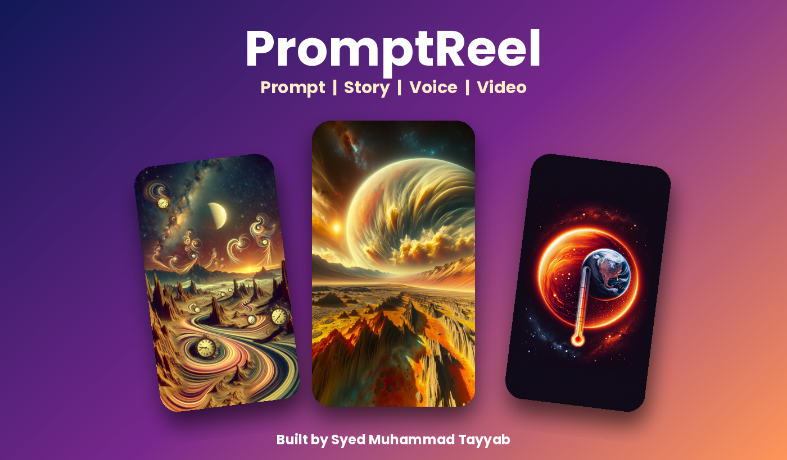
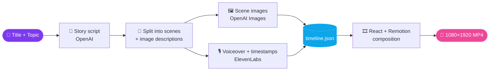

<!-- ═══════════════════════ HEADER ═══════════════════════ -->
<div align="center">


<a href="https://github.com/Syed-Muhammad-Tayyab/PromptReel-AI">
  
</a>

<br/>



<br/><br/>

<a href="https://github.com/Syed-Muhammad-Tayyab/PromptReel-AI/stargazers"></a>
<a href="https://github.com/Syed-Muhammad-Tayyab/PromptReel-AI/network/members"></a>
<a href="https://github.com/Syed-Muhammad-Tayyab/PromptReel-AI/issues"></a>


<br/>


<br/><br/>

<a href="#-quick-start"><b>⚡ Quick Start</b></a> &nbsp;•&nbsp;
<a href="#-how-it-works"><b>🧠 How It Works</b></a> &nbsp;•&nbsp;
<a href="#-project-structure"><b>📂 Structure</b></a> &nbsp;•&nbsp;
<a href="#-generate-your-own-story"><b>🎬 Generate</b></a> &nbsp;•&nbsp;
<a href="#-customization"><b>🎨 Customize</b></a> &nbsp;•&nbsp;
<a href="#-about-the-author"><b>👤 Author</b></a>

</div>

<br/>

---

## ✨ Overview

**PromptReel** is an AI video generator for short-form vertical content. Give it a **story title** and a **topic** (history, ELI5, fun facts, science) and it produces everything a finished reel needs:

| Stage | What happens | Powered by |
| :-- | :-- | :-- |
| 📝 **Script** | Writes a short, hook-first narration for your topic | OpenAI (`gpt-4.1`) |
| 🖼️ **Visuals** | Describes and generates one 1024×1792 image per scene | OpenAI Images |
| 🎙️ **Voiceover** | Narrates each scene with character-level timestamps | ElevenLabs |
| 🧩 **Timeline** | Merges everything into a single `timeline.json` | Custom CLI |
| 🎞️ **Render** | Animated backgrounds, transitions and word-synced subtitles | React + Remotion |

The result is a **1080 × 1920, 30 fps** video, ready for TikTok, Instagram Reels or YouTube Shorts.

---

## 🚀 Features

<table>
  <tr>
    <td width="50%">

🤖 **One-command generation** &nbsp;— title + topic in, full timeline out  
🎙️ **Word-level synced subtitles** &nbsp;— driven by ElevenLabs timestamps  
🌫️ **Scene transitions** &nbsp;— `fade`, `blur` or `none` per slide  
🔍 **Ken-Burns style motion** &nbsp;— scale animations on every background  

   </td>
   <td width="50%">

🧱 **Typed end to end** &nbsp;— Zod schemas for timeline, story and audio  
👀 **Live studio preview** &nbsp;— hot-reload in Remotion Studio  
🗂️ **Multi-story ready** &nbsp;— every folder in `public/content/` becomes a composition  
🎨 **Easy to restyle** &nbsp;— fonts, colors and layout live in plain React components  

   </td>
  </tr>
</table>

---

## 🧠 How It Works



The timeline is built from **three blocks**:

| Block | Purpose |
| :-- | :-- |
| `elements` | Slide backgrounds, enter/exit transitions (e.g. blur) and in-slide animations (e.g. scale) |
| `text` | Subtitle text with start/end times and position (`top`, `center`, `bottom`) |
| `audio` | Voiceover clips, time-aligned with the text |

---

## 🛠️ Tech Stack

<div align="center">


</div>

| Layer | Tools |
| :-- | :-- |
| **Frontend / Video** | React 19, TypeScript, Remotion 4, `@remotion/google-fonts`, `@remotion/animation-utils`, `@remotion/layout-utils` |
| **Validation** | Zod |
| **AI services** | OpenAI (script + images), ElevenLabs (voice + timestamps) |
| **CLI** | Bun, yargs, prompts, ora, chalk, dotenv |
| **Tooling** | ESLint, Prettier, TypeScript strict mode |

---

## 📂 Project Structure

```text
PromptReel-AI/
├── 📁 assets/
│   └── banner.png                  # README banner
├── 📁 cli/
│   ├── cli.ts                      # Interactive generator (npm run gen)
│   ├── service.ts                  # OpenAI + ElevenLabs API calls
│   └── timeline.ts                 # Story → timeline.json builder
├── 📁 public/
│   └── 📁 content/
│       └── 📁 history-of-venus/    # Demo story (one folder per story)
│           ├── descriptor.json     # Script, image prompts, audio timestamps
│           ├── timeline.json       # Final timeline used by the renderer
│           ├── 📁 images/          # Generated scene images (.png)
│           └── 📁 audio/           # Generated voiceover clips (.mp3)
├── 📁 src/
│   ├── 📁 components/
│   │   ├── AIVideo.tsx             # Main composition (intro + scenes + audio)
│   │   ├── Background.tsx          # Image backgrounds, transitions, animation
│   │   ├── Subtitle.tsx            # Subtitle track
│   │   └── Word.tsx                # Animated single word
│   ├── 📁 lib/
│   │   ├── constants.ts            # FPS, intro length, image size
│   │   ├── types.ts                # Zod schemas and TypeScript types
│   │   └── utils.ts                # Timeline loading and frame math
│   ├── Root.tsx                    # Registers one composition per story
│   └── index.ts                    # Entry point
├── .env.example                    # API key template
├── .gitignore
├── .prettierrc
├── eslint.config.mjs
├── package.json
├── remotion.config.ts
├── tsconfig.json
└── README.md
```

---

## ⚡ Quick Start

### Prerequisites

- **Node.js** 18 or newer
- **Bun** (used by the `gen` script) → [bun.sh](https://bun.sh)
- An **OpenAI API key** and an **ElevenLabs API key** *(only needed to generate new stories)*

### 1️⃣ Clone the repository

```bash
git clone https://github.com/Syed-Muhammad-Tayyab/PromptReel-AI.git
cd PromptReel-AI
```

### 2️⃣ Install dependencies

```bash
npm install
```

### 3️⃣ Preview the demo story

```bash
npm run dev
```

Remotion Studio opens in your browser with the **History of Venus** demo story.

### 4️⃣ Render to MP4

```bash
npx remotion render history-of-venus out/history-of-venus.mp4
```

> The composition id is the folder name inside `public/content/`.

---

## 🎬 Generate Your Own Story

### 🔑 Configure keys

Create a `.env` file in the project root (a template is in `.env.example`):

```env
OPENAI_API_KEY=your_openai_key
ELEVENLABS_API_KEY=your_elevenlabs_key
```

> If no `.env` is found, the CLI will prompt you for both keys.

### 🗣️ Choose a voice

Open [`cli/service.ts`](cli/service.ts) and change `voiceId` inside `generateVoice()` to any voice from your ElevenLabs library. You can copy the id from the voice URL (the part after `voiceId=`).

### ▶️ Run the generator

```bash
npm run gen
```

You will be asked for:

| Prompt | Example |
| :-- | :-- |
| **Title** | `Why do cats purr?` — can be short or long and detailed |
| **Topic** | `Fun facts`, `History`, `ELI5`, `Science` |

Or skip the prompts with flags:

```bash
npm run gen -- --title "Secrets of the Pyramids" --topic "History"
```

The CLI then creates `public/content/<your-title>/` with the script, images, audio and `timeline.json`. Run `npm run dev` and your new story appears as a composition.

---

## 🎨 Customization

| I want to change… | Edit this |
| :-- | :-- |
| Title card look (font, colors, border) | [`src/components/AIVideo.tsx`](src/components/AIVideo.tsx) |
| Background transitions & motion | [`src/components/Background.tsx`](src/components/Background.tsx) |
| Subtitle style & word animation | [`src/components/Subtitle.tsx`](src/components/Subtitle.tsx), [`src/components/Word.tsx`](src/components/Word.tsx) |
| Video size, FPS, intro length | [`src/lib/constants.ts`](src/lib/constants.ts) |
| How scenes become a timeline | `createTimeLineFromStoryWithDetails()` in [`cli/timeline.ts`](cli/timeline.ts) |
| Story tone & image style prompts | Prompt builders in [`cli/service.ts`](cli/service.ts) |
| Narrator voice | `voiceId` in [`cli/service.ts`](cli/service.ts) |

---

## 🌐 Deploying as a Remote Service

PromptReel renders locally out of the box. To run it as a hosted service:

1. Deploy the Remotion renderer with this project's bundle (`npm run build`).
2. Update [`src/Root.tsx`](src/Root.tsx) to take a **timeline URL as a prop** instead of a local project name.
3. Upload generated images and audio to storage and use their **URLs** in the timeline instead of file names.

---

## 🗺️ Roadmap

- [ ] Web dashboard to enter a title/topic and download the video
- [ ] Multiple voice and visual style presets
- [ ] Urdu / multilingual narration
- [ ] Background music track with auto-ducking
- [ ] One-click upload to YouTube Shorts

---

## 🧯 Troubleshooting

| Problem | Fix |
| :-- | :-- |
| `bun: command not found` | Install Bun from [bun.sh](https://bun.sh), then re-run `npm run gen` |
| `OpenAI error` / `ElevenLabs error` | Check your API keys, billing and rate limits |
| New story not visible in Studio | Make sure `public/content/<story>/timeline.json` exists, then restart `npm run dev` |
| Outdated render packages | Run `npx remotion upgrade` |

---

## 📜 License & Credits

PromptReel is built on top of **[Remotion](https://www.remotion.dev)**. Remotion is free for individuals and small teams, while some companies need a company license, so please check the [Remotion license terms](https://github.com/remotion-dev/remotion/blob/main/LICENSE.md) before using this commercially.

AI services used: **OpenAI** and **ElevenLabs**, each subject to its own terms.

---

## 👤 About the Author

<div align="center">


<br/><br/>

**Syed Muhammad Tayyab** &nbsp;·&nbsp; 📍 Islamabad, Pakistan  
🎓 BSCS (Information Security) at **FUUAST Islamabad**  
💻 Full-Stack Developer &nbsp;|&nbsp; Security-Minded Engineer &nbsp;|&nbsp; MERN Stack  
🛡️ Cybersecurity interest: SIEM, penetration testing, Red Team

<br/>

<a href="https://github.com/Syed-Muhammad-Tayyab"></a>

<br/><br/>


<br/><br/>


<br/>


</div>

---

## 🤝 Contributing

Ideas and improvements are welcome.

1. Fork the repository
2. Create a branch: `git checkout -b feature/my-feature`
3. Commit your changes: `git commit -m "Add my feature"`
4. Push the branch: `git push origin feature/my-feature`
5. Open a Pull Request

---

<div align="center">

### ⭐ If PromptReel helped you, give it a star!


<sub>Made with ❤️ by <a href="https://github.com/Syed-Muhammad-Tayyab"><b>Syed Muhammad Tayyab</b></a></sub>

</div>
